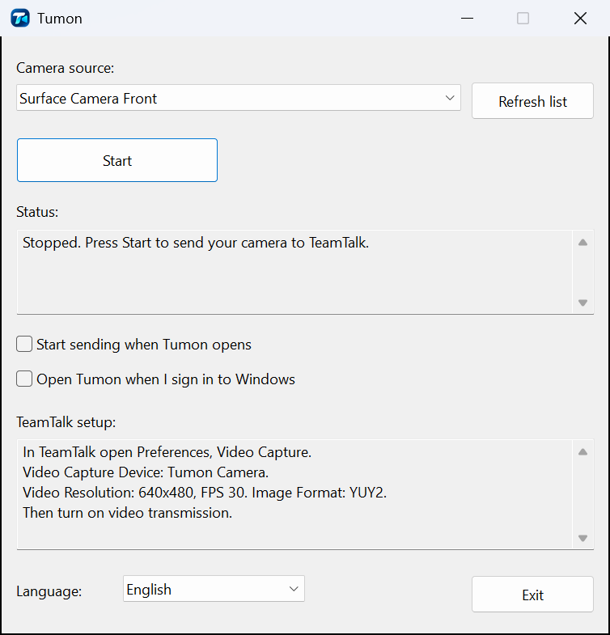
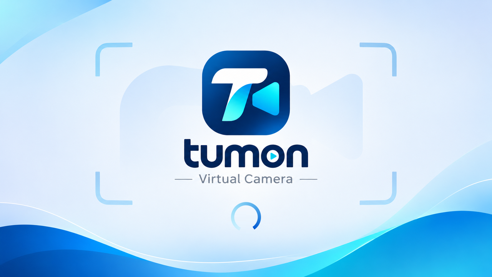
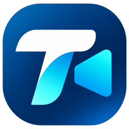

<p align="center">
  
</p>

<h1 align="center">Tumon</h1>

<p align="center">
  <b>A virtual camera for Windows 11 that TeamTalk can see and set up by itself.</b>
</p>

<p align="center">
  Tumon takes the picture from your laptop camera or webcam and presents it as a camera called
  <i>Tumon Camera</i>. <b>TeamTalk 5</b> lists it and fills in its resolution list, so there is no
  "custom video format" to type.<br>
  <i>By SkillsHUB Electronics. Sister project of <a href="https://github.com/SkillsHUB-Electronics/tapis">Tapis</a>, the microphone noise filter.</i>
</p>

<p align="center">
  <a href="https://github.com/SkillsHUB-Electronics/tumon/releases"></a>
  <a href="https://github.com/SkillsHUB-Electronics/tumon/actions/workflows/ci.yml"></a>
  
  <a href="LICENSE"></a>
  <br>
  
  
  
  <a href="https://github.com/SkillsHUB-Electronics/tumon/releases"></a>
</p>

<p align="center">
  <a href="https://github.com/SkillsHUB-Electronics/tumon/releases"></a>
</p>

> **Early preview.** Tried on one Windows 11 PC with TeamTalk 5.23 and its built-in camera. The installer is **not
> code-signed**. Read the [known limitations](docs/release-notes/v0.1.0.md#known-limitations) first.
> Bahasa Indonesia: lihat [catatan rilis](docs/release-notes/v0.1.0.md#bahasa-indonesia).

<p align="center">
  <a href="#a-tour">A tour</a> ·
  <a href="#why-tumon">Why Tumon</a> ·
  <a href="#what-works-today">What works today</a> ·
  <a href="#install">Install</a> ·
  <a href="#build-from-source">From source</a> ·
  <a href="#architecture">Architecture</a> ·
  <a href="#roadmap">Roadmap</a> ·
  <a href="#contributing">Contributing</a> ·
  <a href="#license-privacy-and-credits">License</a>
</p>

## A tour

<table>
<tr>
<td width="42%" valign="top"><p align="center"><sub><b>The app.</b> Choose a camera, press Start. The TeamTalk settings to pick are written in the window, where a screen reader can read them.</sub></p></td>
<td width="58%" valign="top"><p align="center"><sub><b>No source yet.</b> The logo with a turning circle, so the other side can tell the video is alive. In the next version; 0.1.0 shows colour bars.</sub></p></td>
</tr>
</table>

## Why Tumon

TeamTalk is popular with blind and low-vision users, and it is picky about cameras:

- **It lists only real Windows cameras** (Media Foundation). OBS Virtual Camera and recent SplitCam are DirectShow
  filters, so TeamTalk does not show them.
- **It fills its resolution list only from YUY2 formats.** A laptop camera that offers only NV12 leaves you typing a
  "custom video format", and it fails if one number is wrong.

Tumon is a real Windows camera that offers YUY2 and converts what your camera gives. The measurements behind this are
in [docs/research](docs/research/teamtalk-iriun-findings.md), and the decision is
[ADR 0001](docs/decisions/0001-media-foundation-virtual-camera.md).

- **Camera on only while used.** Your real camera opens when a program uses Tumon Camera and closes afterwards.
- **Built for keyboard and screen readers.** Standard Windows controls, in English and Bahasa Indonesia.
- **Local.** Tumon itself sends nothing over the network. MIT-licensed source.

## What works today

| Area | Highlights |
|---|---|
| **Virtual camera** | "Tumon Camera" as a permanent Windows camera; YUY2, NV12, RGB32 and I420 at 320x240, 640x480 and 1280x720, 30 fps |
| **Sources** | A laptop camera (USB webcams are not yet tested) |
| **Picture** | Fitted into the chosen size without stretching |
| **App** | Camera list, Start and Stop, tray icon, start sending on open, open at sign-in |
| **Interface** | English and Bahasa Indonesia; not yet tried by a screen-reader user |
| **TeamTalk** | Listed by TeamTalk 5.23, resolution list filled, video received by a second PC |

Details for each release are in the [changelog](CHANGELOG.md); what comes next is in the [roadmap](ROADMAP.md).

## Install

1. Download **`Tumon-Setup-<version>.exe`** from the [releases page](https://github.com/SkillsHUB-Electronics/tumon/releases).
2. Run it (administrator). The preview is not code-signed, so Windows SmartScreen may warn: compare the file's
   SHA-256 with the one on the release page, then choose *More info* and *Run anyway*.
3. Open **Tumon**, choose your camera, press **Start**.
4. In TeamTalk, *Preferences › Video Capture*: device **Tumon Camera**, **640x480, FPS 30**, image format **YUY2**.
   Then turn on video transmission.

Something not working? See [troubleshooting](docs/troubleshooting.md).

## Build from source

Needs Visual Studio 2022 Build Tools (C++ and the Windows 11 SDK) and CMake. Build outside synced folders:

```powershell
git clone https://github.com/SkillsHUB-Electronics/tumon
cd tumon
cmake -S cpp -B $env:USERPROFILE\build\tumon -G "Visual Studio 17 2022" -A x64
cmake --build $env:USERPROFILE\build\tumon --config Release
ctest --test-dir $env:USERPROFILE\build\tumon -C Release --output-on-failure
```

The tests need no installation or administrator rights. The installer and trying the camera are covered in
[docs/building.md](docs/building.md) and [tools/test-camera](tools/test-camera/README.md).

## Architecture

```
Camera ─▶ Tumon.exe (read, convert to YUY2) ─▶ shared memory ─▶ Tumon Camera ─▶ TeamTalk
                                                                (in the Windows camera service)
```

| Layer | Path | Job |
|---|---|---|
| Camera | [`cpp/src/source`](cpp/src/source) | Media Foundation media source, loaded by the Windows Frame Server |
| Channel | [`cpp/src/channel`](cpp/src/channel) | Shared-memory hand-over of pictures from the app to the camera |
| Engine | [`cpp/src/feeder`](cpp/src/feeder) | Reads the real camera only while Tumon Camera is in use |
| App | [`cpp/app`](cpp/app) | Native Win32 window and tray icon ([ADR 0002](docs/decisions/0002-native-win32-app.md)) |
| Tools | [`cpp/tools`](cpp/tools) | Register the camera, feed from a terminal, self-test, list camera formats |
| Packaging | [`packaging/windows`](packaging/windows) | Inno Setup installer |

More in [docs/architecture.md](docs/architecture.md) and the [documentation index](docs/README.md).

## Roadmap

Tumon is an **early preview**. Ideas being worked on or considered include testing USB webcams and more PCs, a
code-signed installer, limiting who can send pictures to the camera, simple effects (flip, crop, brightness) and a
phone as a camera. Details: [ROADMAP.md](ROADMAP.md).

## Contributing

Bug reports, feature ideas and pull requests are welcome. Start with [CONTRIBUTING.md](CONTRIBUTING.md),
use the [issue templates](https://github.com/SkillsHUB-Electronics/tumon/issues/new/choose), and report security
problems privately as described in [SECURITY.md](SECURITY.md). Everyone taking part follows the
[code of conduct](CODE_OF_CONDUCT.md). AI agents: start with [AGENTS.md](AGENTS.md).

## License, privacy and credits

Tumon's source code is under the [MIT License](LICENSE). Copyright (c) 2026 SkillsHUB Electronics. The camera follows
the pattern shown by Simon Mourier's MIT-licensed VCamSample; see [THIRD_PARTY_NOTICES.md](THIRD_PARTY_NOTICES.md).
The [privacy policy](PRIVACY.md) explains what happens to your video.

Tumon is not affiliated with Iriun, OBS, SplitCam or BearWare.dk (TeamTalk). Those names are used only to say what
Tumon works with or was compared against.

<p align="center">
  <br>
  <sub>Made by <a href="https://github.com/SkillsHUB-Electronics">SkillsHUB Electronics</a>.</sub>
</p>
